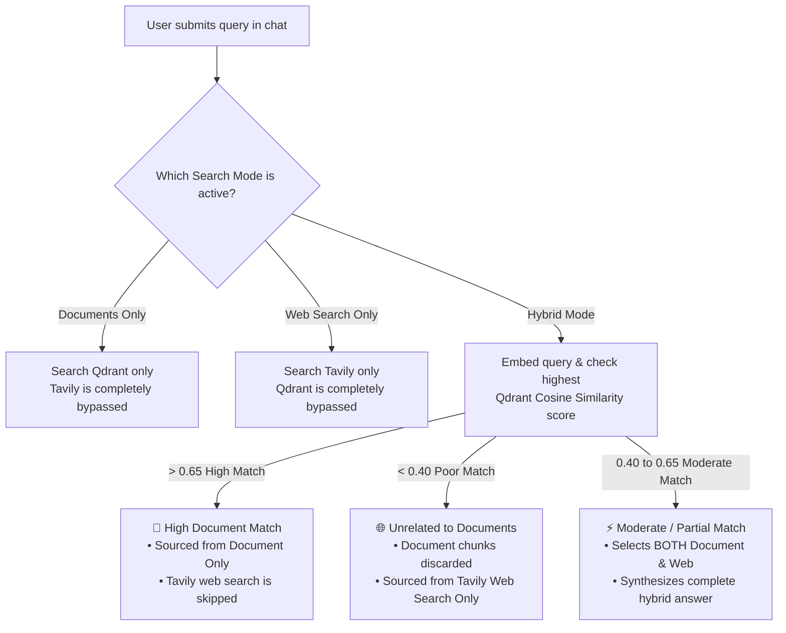
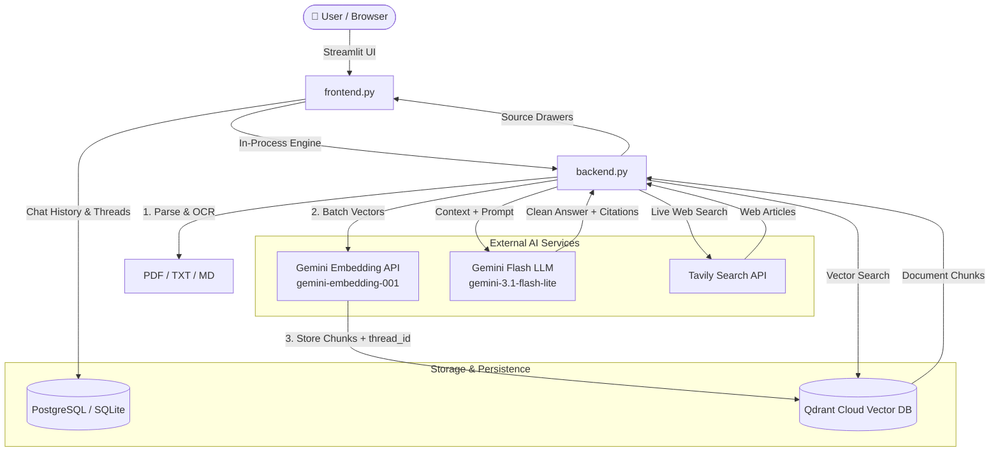

# ⚡ OmniRAG: Hybrid Conversational RAG Engine

> An enterprise-grade, multi-thread **Hybrid Retrieval-Augmented Generation (RAG)** application combining **Qdrant Cloud Vector DB**, **Google Gemini Embeddings & Flash LLM**, and **Tavily AI Search**.

---

## 🌟 Key Features

- **Adaptive Hybrid Search Routing:** Automatically evaluates vector cosine similarity to route queries to Documents Only, Live Web Search, or Both.
- **Thread-Isolated Vector Storage:** Each chat conversation has its own isolated vector space in Qdrant using metadata payload filtering (`thread_id`).
- **Encrypted & Scanned PDF Support:** Native password decryption for password-locked PDFs (e.g. e-Aadhaar cards) and automatic fallback to **Gemini Multimodal OCR** for scanned image-based PDFs.
- **Strict Grounding & Zero Hallucination:** In *Documents Only* mode, the system strictly answers using only your uploaded files and explicitly refuses if facts are missing.
- **Real-Time Vector Purging:** Deleting a chat thread immediately purges its vector points from Qdrant Cloud with live counter updates.
- **Production-Ready Multi-Thread Database:** Supports **PostgreSQL** (for cloud deployment on Render) with automatic fallback to local **SQLite**.
- **Multi-Model LLM Resilience:** Automated model cascade (`gemini-3.1-flash-lite` → `gemini-3.5-flash-lite` → `gemini-flash-latest`) guaranteeing 99.9% uptime during traffic spikes or free-tier quota limits.

---

## 🧠 Adaptive Hybrid Routing Logic

When a query is submitted in **Hybrid Mode**, the system dynamically determines whether the question should be answered from your private vector database, live web search, or a synthesis of both:



### Routing Threshold Breakdown:
1. **Cosine Score $> 0.65$ (Document Only):** High-confidence semantic match (e.g. candidate details, private project data). Tavily is skipped to save API calls and network latency.
2. **Cosine Score $< 0.40$ (Tavily Web Only):** Statistical noise (e.g. asking about global politics on a software resume). Low-score document chunks are discarded to avoid confusing the LLM.
3. **Cosine Score between $0.40$ and $0.65$ (Select Both):** The document contains partial context while external facts are needed. Both knowledge streams are provided to Gemini for full synthesis.

---

## 🏗️ High-Level Architecture



---

## 🛠️ Tech Stack

| Component | Technology | Description |
| :--- | :--- | :--- |
| **Frontend UI** | `Streamlit` | Multi-thread chat interface, file uploader, top-k controls, and source drawers. |
| **Backend REST API** | `FastAPI` / `Uvicorn` | Optional standalone REST API with auto-generated Swagger documentation at `/docs`. |
| **Vector Database** | `Qdrant Cloud` | Managed cloud vector database storing 768-dimensional embeddings with payload indexing. |
| **Embedding Model** | `gemini-embedding-001` | High-dimensional dense embeddings (`task_type="RETRIEVAL_DOCUMENT"` / `"RETRIEVAL_QUERY"`). |
| **Generation LLM** | `gemini-3.1-flash-lite` | Ultra-fast, low-latency reasoning and grounded answer synthesis. |
| **Web Search** | `Tavily Search API` | AI-optimized search engine delivering clean, ad-free factual content. |
| **Chat DB** | `PostgreSQL` / `SQLite` | Persistent storage for chat threads, messages, and source metadata. |
| **PDF Processing** | `pypdf` + Gemini OCR | PDF extraction, password decryption (e-Aadhaar), and multimodal vision fallback. |

---

## 🚀 Quickstart Guide

### 1. Prerequisites
- Python 3.9+ installed
- Free API Keys from:
  - [Google AI Studio](https://aistudio.google.com/) (`GEMINI_API_KEY`)
  - [Qdrant Cloud](https://cloud.qdrant.io/) (`QDRANT_URL` and `QDRANT_API_KEY`)
  - [Tavily AI](https://app.tavily.com/) (`TAVILY_API_KEY`)

### 2. Installation
```bash
# Clone the repository
git clone <your-repo-url>
cd RAG

# Create and activate virtual environment
python3 -m venv venv
source venv/bin/activate

# Install dependencies
pip install -r requirements.txt
```

### 3. Configure Environment Variables
Create a `.env` file in the project root:
```env
# Gemini AI
GEMINI_API_KEY=your_gemini_api_key_here
GEMINI_EMBEDDING_MODEL=gemini-embedding-001
GEMINI_GENERATION_MODEL=gemini-3.1-flash-lite

# Tavily Search
TAVILY_API_KEY=your_tavily_api_key_here

# Qdrant Cloud Vector Database
QDRANT_URL=https://your-cluster-id.cloud.qdrant.io:6333
QDRANT_API_KEY=your_qdrant_api_key_here
QDRANT_COLLECTION_NAME=rag_knowledge_base

# Database (Leave empty for local SQLite; add Render PostgreSQL URL when deploying)
DATABASE_URL=
```

### 4. Run the Application
You can run the full in-process application with a single command:
```bash
streamlit run frontend.py
```
Open **`http://localhost:8501`** in your browser.

*(Optional) To run the standalone FastAPI backend separately:*
```bash
python backend.py
```
Swagger UI will be available at **`http://localhost:8000/docs`**.

---

## 🌐 Deploying on Render

1. Create a new **Web Service** on [Render](https://render.com/).
2. Connect your GitHub repository.
3. Set the following Build and Start commands:
   - **Build Command:** `pip install -r requirements.txt`
   - **Start Command:** `streamlit run frontend.py --server.port $PORT --server.address 0.0.0.0`
4. Create a free **PostgreSQL Database** on Render, copy its **Internal Database URL**, and paste it into the `DATABASE_URL` environment variable under your Web Service settings.
5. Add your `GEMINI_API_KEY`, `TAVILY_API_KEY`, `QDRANT_URL`, and `QDRANT_API_KEY` in Render's **Environment** tab.

---

## 📂 Project Structure

```
.
├── backend.py              # Core RAG engine, Qdrant/Gemini/Tavily integrations & REST API
├── frontend.py             # Streamlit web UI, multi-thread sidebar & source drawers
├── chat_history.py         # PostgreSQL & SQLite database engine for chat persistence
├── requirements.txt        # Python package dependencies
├── .streamlit/
│   └── config.toml         # Streamlit server configuration & 2MB file limit
├── .env.example            # Template for environment configuration
└── README.md               # Project documentation
```

---

## 📜 License
MIT License. Feel free to use and customize for your own projects!
